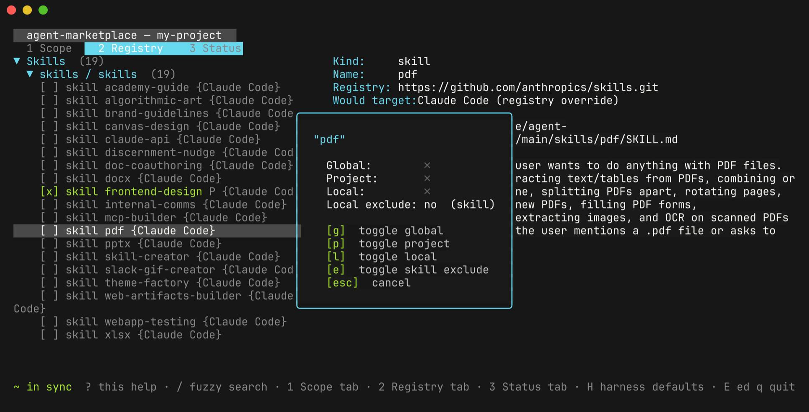
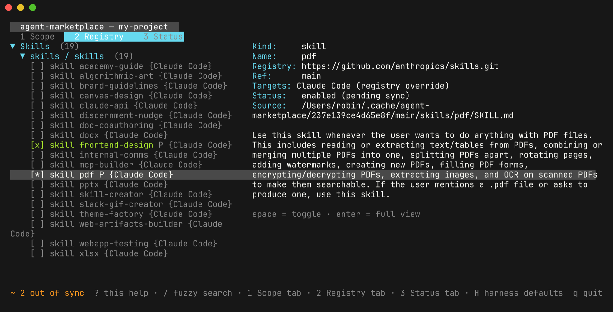
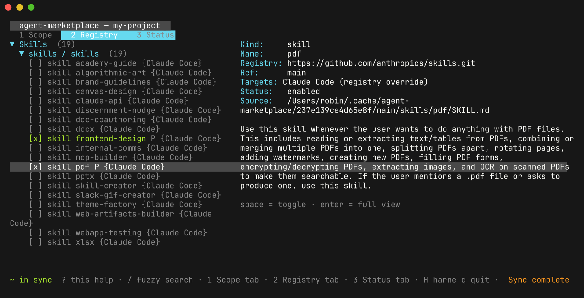

# Quick start

If `agent-marketplace` is not installed yet, see [Install](./install.md). Then open a terminal in a project you work on with a coding agent:

```bash
cd ~/code/my-project
```

In about five minutes you will point the project at a public skill registry, pick skills in the interactive UI, and commit a config that lets teammates reproduce the same setup with one command.

## Launch

Run the binary with no arguments:

```bash
agent-marketplace
```

On first launch there is no personal configuration yet, so the UI asks which coding harnesses it should write into. Harnesses it detects on your machine are pre-selected:


Move with `j`/`k`, toggle with `space`, and press `enter`. The choice is saved to `~/.agents/config.yaml`. The rest of this page assumes Claude Code; substitute your own harness where paths mention `.claude`.

Press `q` to leave the UI for a moment.

## Point the project at a registry

A registry is a Git repository that holds skills, commands, subagents, hooks, or MCP servers. The UI can browse and toggle anything in a configured registry, but adding the registry itself is a one-off CLI step. Use Anthropic's public skills repository and install one skill from it:

```bash
agent-marketplace install frontend-design \
  --from https://github.com/anthropics/skills.git \
  --ref main \
  --path skills
```

The first run clones the registry, so it takes a few seconds. Then:

```text
Installed frontend-design in this repo
```

Two files now exist under `.agents/` in your project:

- `config.yaml` records what you asked for: the registry, its ref, and the `frontend-design` selection.
- `lock.yaml` records the exact commit that was resolved and a content digest for every resource in the registry.

```yaml
# .agents/config.yaml
apiVersion: agent-marketplace/v2
registries:
  - url: https://github.com/anthropics/skills.git
    ref: main
    path: skills
    skills:
      include:
        - frontend-design
```

The skill has also been materialized. For Claude Code it lives at `.claude/skills/frontend-design/`, as a link into the local registry cache.

## Browse and toggle in the UI

Launch the UI again:

```bash
agent-marketplace
```

Press `2` for the **Registry** tab. Every skill the registry offers is listed, and the right pane describes whichever one is selected. `frontend-design` is checked and marked `P` because it is enabled at project scope.

Move down to `pdf` with `j` (or type `/pdf` to filter the list) and press `space`. A modal shows where the resource is currently enabled and asks which scope to toggle:



Press `p`. The selection is written to `.agents/config.yaml` immediately. The row changes to `[*]`, its status reads `enabled (pending sync)`, and the footer switches from `~ in sync` to `~ 2 out of sync`, because nothing has been written to `.claude/` yet:



Press `s` to sync. The footer returns to `~ in sync`, a `Sync complete` toast appears, and `pdf` now shows as `[x]`:



Before enabling a skill you can read it. Press `enter` on any row to open its files; `SKILL.md` is selected first, and `j`/`k` move through the rest. `esc` returns to the list.


Press `q` to quit. If you quit with pending changes, the UI offers to sync first (`y` syncs and quits, `n` quits without syncing).

## Check what landed

```bash
agent-marketplace status
```

The relevant sections look like this:

```text
TARGET HARNESS SET
TARGET HARNESSES  SOURCE
claude            USER

EXACT REGISTRY LOCKS
SOURCE  REGISTRY                              REF   COMMIT                                         SNAPSHOT
REPO    https://github.com/anthropics/skills  main  sha1:34040c9c568585f6929bedeaad110ad08f079624  available

SYNCED RESOURCES
KIND   NAME             HARNESS  SOURCE  ...  REGISTRY                                  REF   CACHE
skill  frontend-design  claude   REPO    ...  https://github.com/anthropics/skills.git  main  locked: sha1:34040c9c...
skill  pdf              claude   REPO    ...  https://github.com/anthropics/skills.git  main  locked: sha1:34040c9c...

DRIFT
In sync
```

The generated output is on disk:

```bash
ls .claude/skills/
```

```text
frontend-design  pdf
```

Start a new Claude Code session in the project and it picks the skills up.

## Commit the config, not the output

Commit the two files under `.agents/`. Ignore the generated harness output, which is recreated from the lock on every sync:

```bash
echo '.claude/skills/' >> .gitignore
git add .agents/config.yaml .agents/lock.yaml .gitignore
git commit -m "Add agent-marketplace skills"
```

A teammate who clones the project runs one command to get the identical skills at the identical commit:

```bash
agent-marketplace sync
```

In CI, `agent-marketplace sync --check` exits non-zero if the config, lock, and generated output disagree.

## Where next

- [Install your first skill for Claude Code](./tutorials/install-your-first-skill.md): the same flow, CLI only, installed user-wide instead of per project.
- [Install from a hosted Marketplace](./how-to/install-from-a-marketplace.md): search and install verified resources from a Marketplace server instead of a raw Git URL.
- [TUI reference](./reference/tui.md): every key binding and modal action.
- [Command-line reference](./reference/cli.md): `list`, `install`, `remove`, `sync`, `update`, `status`, and every flag.
- [Repository configuration reference](./reference/configuration.md): everything `.agents/config.yaml` accepts, including per-registry harness narrowing, excludes, and tags.
