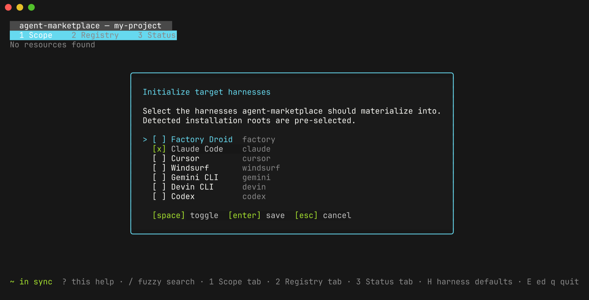
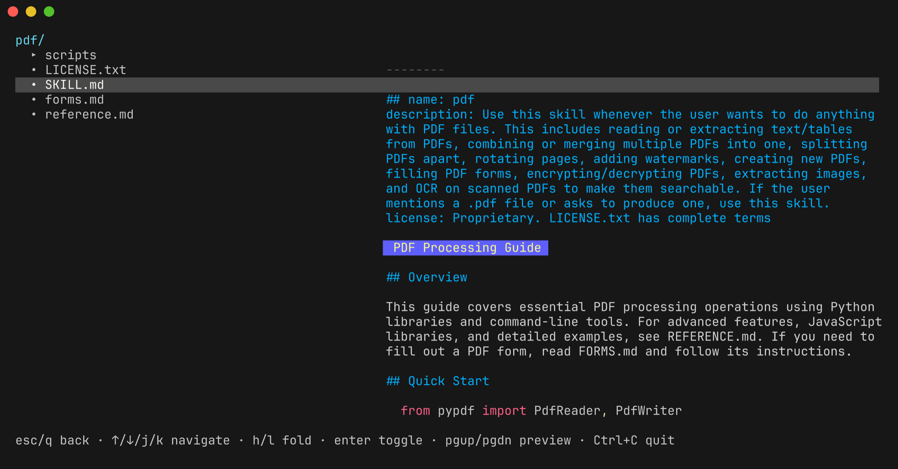

# Quick start

In about ten minutes you will install `agent-marketplace`, connect a project to a public skill registry, install one skill for Claude Code, look at it in the terminal UI, and commit the files that let teammates get the same setup with one command.

## Before you begin

You need:

- Git. Run `git --version` to check.
- A project folder that is a Git repository. If it isn't one yet, run `git init` inside it.
- Claude Code, if you want to use the skill at the end.

## Install

The install script detects your platform, verifies the release checksum, and installs to `~/.local/bin` without `sudo`:

```bash
curl -fsSL https://agent-marketplace.io/install.sh | bash
```

Check that it works:

```bash
agent-marketplace --version
```

If the terminal answers `command not found`, add `~/.local/bin` to your `PATH`. The install script prints the export line to add.

Releases up to v5.0.0 don't publish the checksums the script needs; until a newer release exists, install with Go 1.26.9 or newer:

```bash
go install github.com/Adyen/agent-marketplace/cmd/agent-marketplace@latest
```

If Go reports a `404` or an authentication error, run `export GOPRIVATE="${GOPRIVATE:+$GOPRIVATE,}github.com/Adyen/agent-marketplace"` and try again. Go puts the program in `$(go env GOBIN)` if set, otherwise `$(go env GOPATH)/bin` (usually `~/go/bin`). Add that folder to your `PATH` if it isn't there. To download a release binary or build from source, see [more install options](./install.md).

::: tip Coming from an older version?
`agent-marketplace` refuses to load a root configuration file that doesn't declare `apiVersion: agent-marketplace/v4` (included fragments may omit it): commands exit with an error and the TUI shows it, naming the file. [Convert configuration before upgrading](./how-to/migrate-configuration.md) explains how to fix it.
:::

## Open your project

Open a terminal and move into your project folder. Replace the path with your own:

```bash
cd ~/code/my-project
```

This quick start uses Claude Code so the paths and screenshots match. The same steps work for the other six supported [harnesses](./glossary.md#harness), which are coding tools such as Claude Code or Cursor. The [harnesses and output paths reference](./reference/harnesses-and-output-paths.md) lists where each keeps its files, and [How to configure multiple harnesses](./how-to/configure-multiple-harnesses.md) covers switching later.

## Launch

Run the program with no arguments:

```bash
agent-marketplace
```

This opens the terminal UI (TUI), a full-screen interface that you control with the keyboard.

On first launch you have no personal configuration yet, so the TUI asks which harnesses it should install resources into. Harnesses it finds on your computer are already checked:



Make sure only **Claude Code** is checked. Move with the arrow keys, check or uncheck a harness with `space`, and press `enter` to save. The TUI saves your choice to `~/.agents/config.yaml`, your personal configuration file.

If the TUI opens without asking, you already have a personal configuration. Press `H` to see or change its harness list.

Press `q` to leave the TUI for now.

## Point the project at a registry

A [registry](./glossary.md#registry) is a Git repository that holds skills, commands, subagents, hooks, or MCP servers. You tell `agent-marketplace` about it in the project's configuration file, `.agents/config.yaml`. The file has two parts: `sources` names where resources come from, and `resources` says which of them to install from each source. [Sources and resources](./explanation/sources-and-resources.md) explains how the two fit together.

Copy this whole block, including the final `EOF` line, and run it. It creates the folder `.agents` and writes the configuration file. If the project already has `.agents/config.yaml`, add the source and resource to it by hand instead, because the block replaces the file:

```bash
mkdir -p .agents
cat > .agents/config.yaml <<'EOF'
apiVersion: agent-marketplace/v4
harnesses:
  - claude
sources:
  skills:
    git: https://github.com/anthropics/skills.git
    ref: main
    path: skills
resources:
  skills:
    include:
      - skill/frontend-design
EOF
```

This configuration declares one source named `skills`: the `skills` folder of Anthropic's public repository, on the `main` branch. It then asks for one skill from that source, `frontend-design`, for Claude Code.

Run the first sync:

```bash
agent-marketplace sync
```

[Sync](./glossary.md#sync) downloads the registry, writes the skill into Claude Code's folders, and records the exact [commit](./glossary.md#commit) it used in a new [lockfile](./glossary.md#lockfile), `.agents/lock.yaml`. You should see a summary like this:

```text
Installed 2  Removed 0  Malformed 0  Errors 0
  → ~/code/my-project/.claude/.claude-plugin (1 written), ~/code/my-project/.claude/skills (1 written)
```

"Installed" counts files written. The skill itself is one of them; the other is a Claude Code manifest that lists the installed skills.

If sync fails:

- An error that mentions `git` usually means Git isn't installed or can't reach GitHub. Check `git --version` and your network connection.
- If the summary lists folders other than `.claude`, check that the `harnesses:` lines in `.agents/config.yaml` match the block above.
- An error with a code such as `v4.undefined-source` points at a mistake in the configuration, and the message names the setting. Compare your file with the block above; the indentation must match.

The lockfile keeps every teammate on the same commit even when `main` moves. For a team setup, you can also replace `main` with a release tag or a commit before you commit the files.

## Browse the configured source

Open the TUI again:

```bash
agent-marketplace
```

The single list groups every resource by status; the source's resources appear under **Available**, and the right pane describes the highlighted one.

You can read a skill before you install it. Highlight a row and press `enter` to open its files. `SKILL.md` opens first, and the arrow keys move through the other files. Press `esc` to go back to the list.



To install another skill from the list, highlight it and press `space`, then press `p` to add it to the project configuration. Press `s` to sync it. You can also edit the `resources` part of `.agents/config.yaml` by hand and run `agent-marketplace sync`.

Press `q` to quit. If you selected something and didn't sync it yet, the TUI asks whether to sync before quitting.

## Check what landed

```bash
agent-marketplace status
```

`status` prints several tables. These matter here (your commit and paths differ):

```text
TARGET HARNESS SET
TARGET HARNESSES  SOURCE
claude            REPO

EXACT REGISTRY LOCKS
SOURCE  REGISTRY                              REF   COMMIT                                         SNAPSHOT
REPO    https://github.com/anthropics/skills  main  sha1:34040c9c568585f6929bedeaad110ad08f079624  available

SYNCED RESOURCES
KIND   NAME             HARNESS  SOURCE  ...  REGISTRY                                  REF   CACHE
skill  frontend-design  claude   REPO    ...  https://github.com/anthropics/skills.git  main  locked: sha1:34040c9c...

DRIFT
In sync
```

Read them like this:

- `TARGET HARNESS SET` shows that the project configuration (`REPO`) selected `claude`.
- `EXACT REGISTRY LOCKS` shows the commit recorded for `main`.
- `SYNCED RESOURCES` has a row for `frontend-design`.
- `DRIFT` says `In sync`, so the files on disk match the configuration.

The skill is on disk:

```bash
ls .claude/skills/
```

```text
frontend-design
```

Start a new Claude Code session in the project, and it picks up the skill.

## Commit the config, not the output

Commit the configuration and the lockfile. Keep the generated Claude Code files out of Git, because sync recreates them from the lockfile. Other harnesses write to different folders; the [output paths reference](./reference/harnesses-and-output-paths.md) lists them.

```bash
printf '%s\n' '.claude/skills/' '.claude/.claude-plugin/' >> .gitignore
git add .agents/config.yaml .agents/lock.yaml .gitignore
git commit -m "Add agent-marketplace skills"
```

A teammate who clones the project runs one command to get the same skill at the same commit:

```bash
agent-marketplace sync
```

On a fresh CI runner, run `agent-marketplace sync --locked`. It downloads the exact commits and writes the files without changing the configuration or lockfile. Then run `agent-marketplace sync --check`, which exits with status `1` if anything is out of date. See [keeping resources reproducible](./how-to/keep-resources-reproducible.md).

## Where next

- [Configure multiple harnesses](./how-to/configure-multiple-harnesses.md): add Cursor, Codex, Devin, or others alongside Claude Code.
- [Install your first skill for Claude Code](./tutorials/install-your-first-skill.md): the same flow using only commands, installed for your user instead of one project.
- [Install from a hosted Marketplace](./how-to/install-from-a-marketplace.md): connect a Marketplace, or install from a browser URL.
- [User journeys](./explanation/user-journeys.md): what each stage of a resource's life decides, from finding it to removing it.
- [TUI reference](./reference/tui.md): every key and modal action.
- [Command-line reference](./reference/cli.md): `list`, `install`, `remove`, `sync`, `update`, `status`, and every flag.
- [Sources and resources](./explanation/sources-and-resources.md): what the `sources` and `resources` parts of the configuration do.
- [Repository configuration reference](./reference/configuration.md): every v4 source, resource group, harness, and materialization field.
