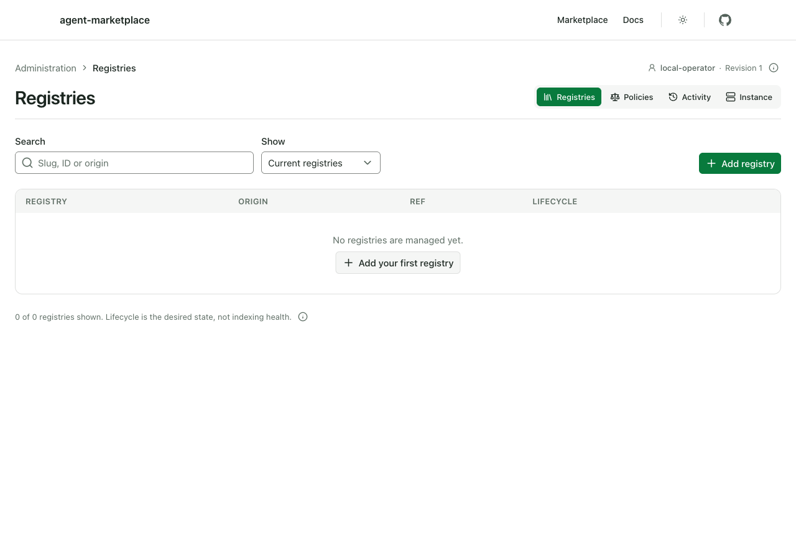
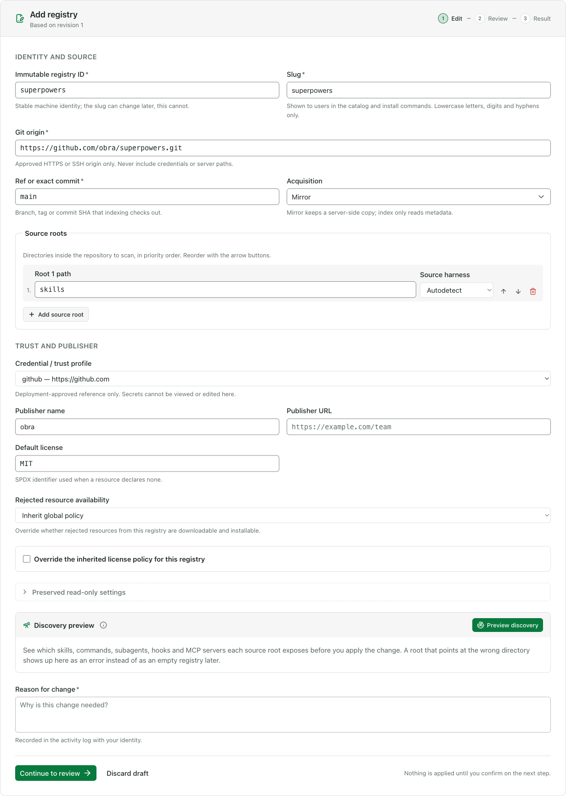
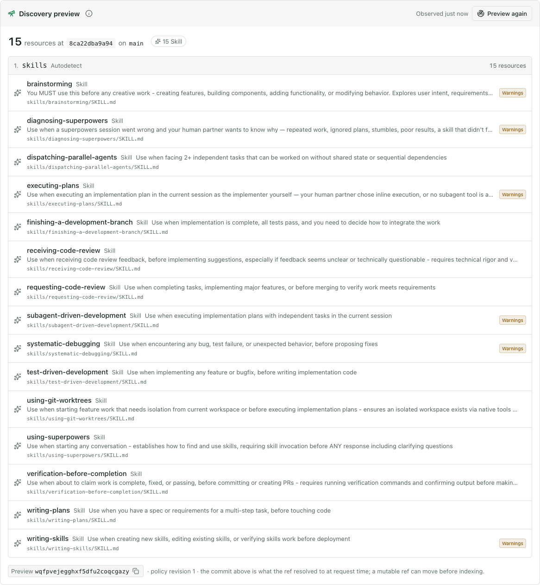
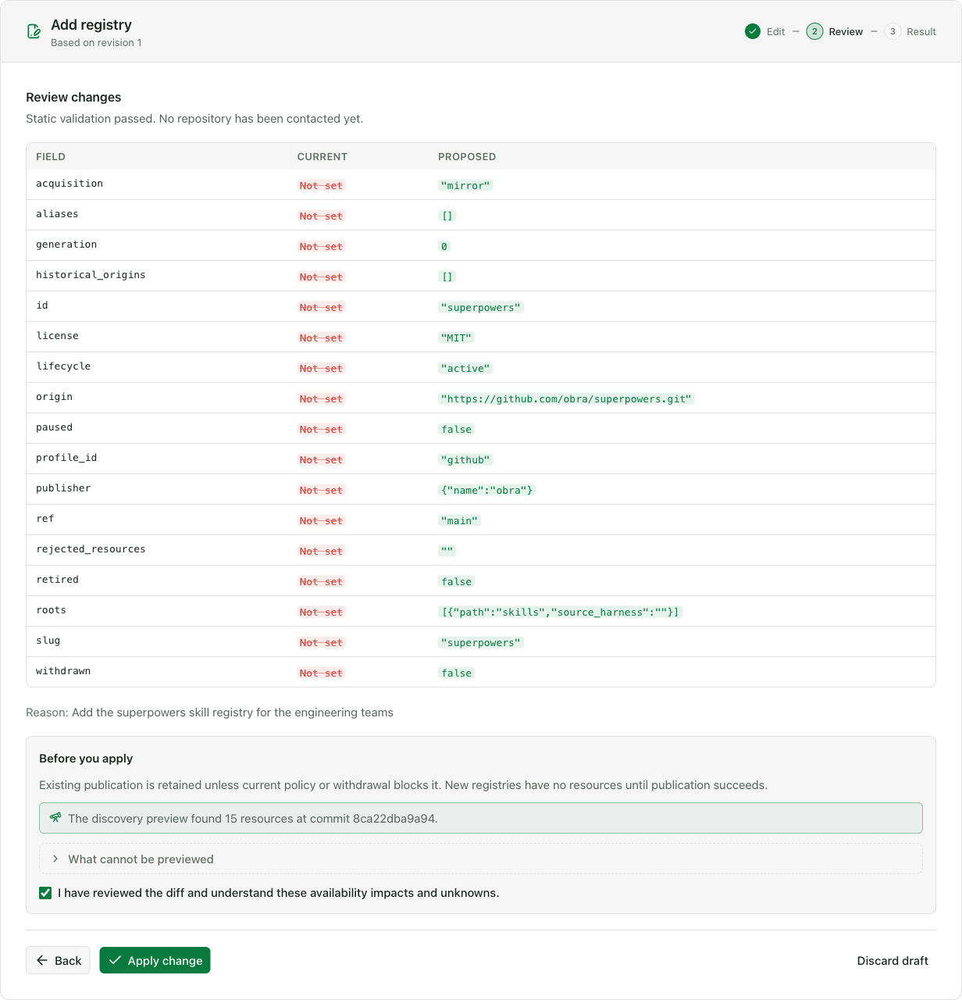
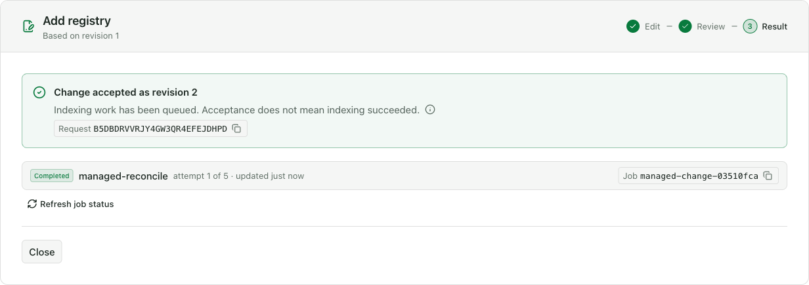
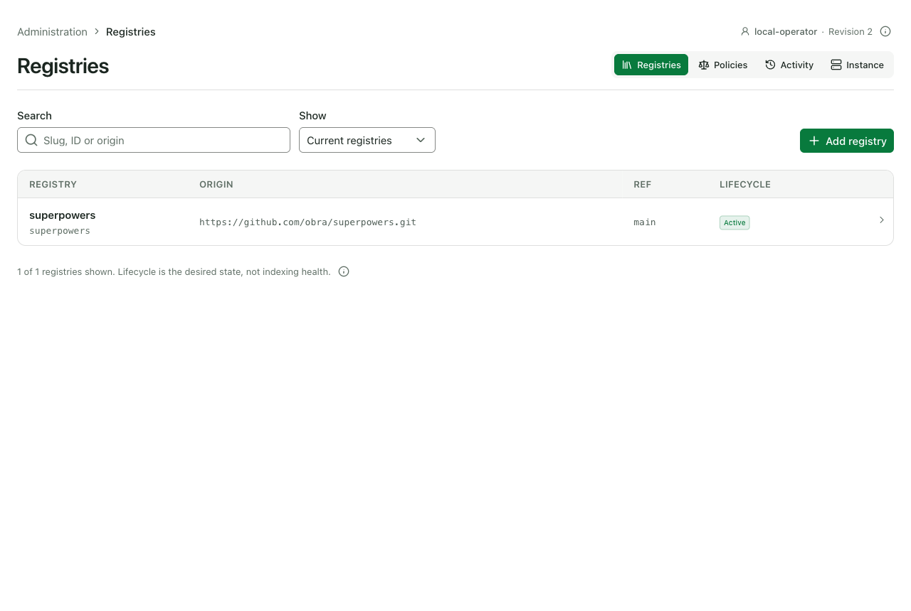
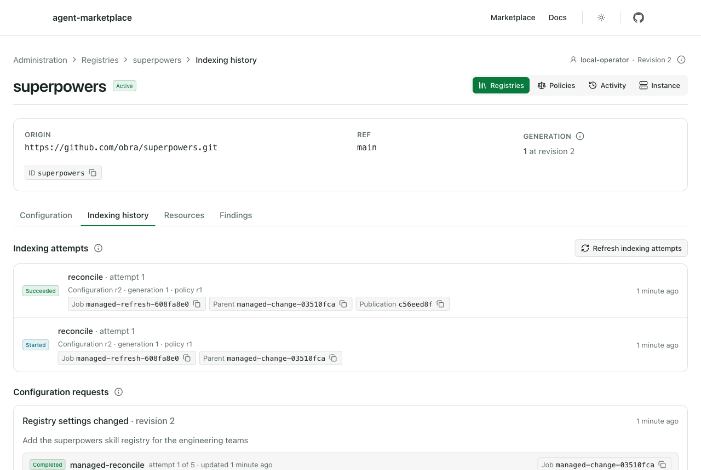
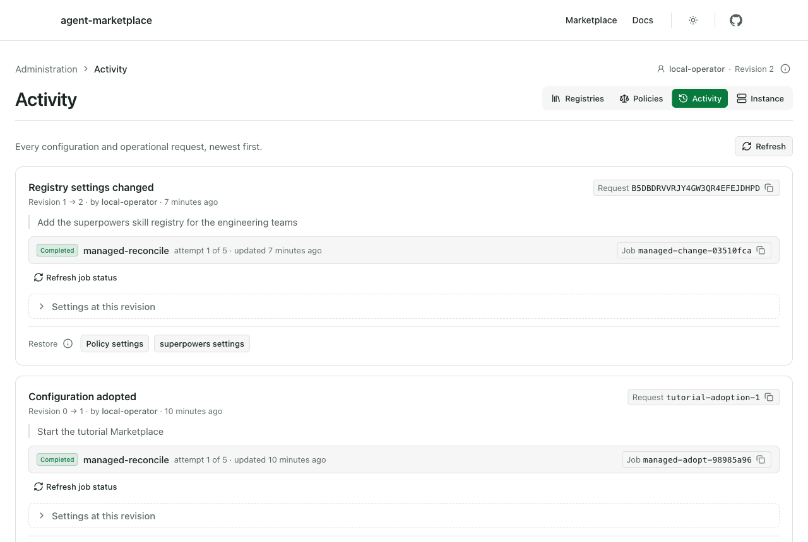
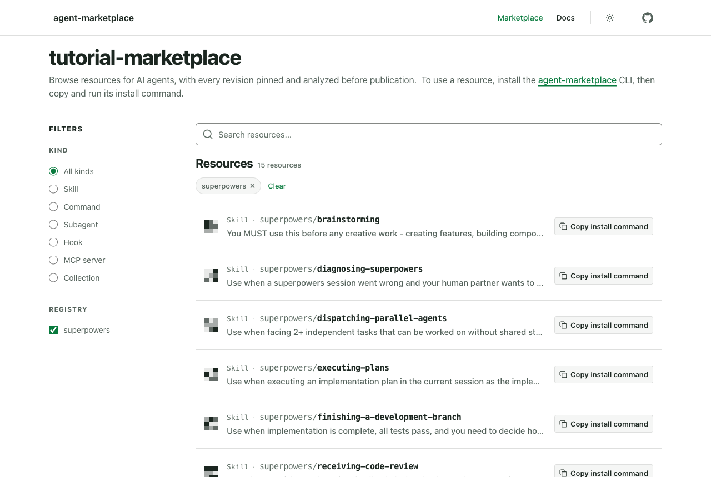
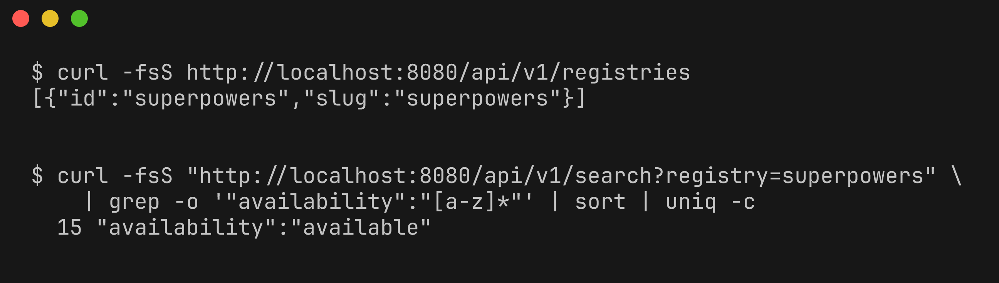

# Add your first registry to a Marketplace

In this tutorial, you start a local Marketplace with the admin panel turned on, add a public Git registry from your browser, and check that its skills are published in the catalog.

You work in a throwaway copy of the repository with a Docker volume that you delete at the end, so your real configuration and data stay untouched.

## Before you begin

You need:

- Docker with Docker Compose 2.24.4 or later.
- `git` and `curl`.
- A browser.
- The `agent-marketplace` repository checked out.

Confirm your Compose version:

```bash
docker compose version
```

Expected output (your version may be newer):

```text
Docker Compose version v2.24.4
```

The tutorial needs port `8080` and the Docker subnet `172.30.89.0/24` to be free. If you already run a local Marketplace from this repository, run `docker compose stop` in that checkout first.

Run all steps in the same terminal window so the `TUTORIAL_ROOT` variable from step 1 stays set.

## 1. Make a throwaway checkout

From the repository root, clone the repository into a temporary directory and move into the clone:

```bash
TUTORIAL_ROOT=$(mktemp -d)
git clone . "$TUTORIAL_ROOT/agent-marketplace"
cd "$TUTORIAL_ROOT/agent-marketplace"
```

Give this copy its own Compose project name, so its containers and data volume stay separate from any other local Marketplace:

```bash
echo "COMPOSE_PROJECT_NAME=marketplace-tutorial" > .env
```

## 2. Write the operator configuration

Create an operator configuration that keeps registry settings in the database and turns on the admin panel for `http://localhost:8080`:

```bash
cat > deploy/compose/sqlite-filesystem/config-mounted.local.yaml <<'EOF'
apiVersion: agent-marketplace.io/marketplace/v1
instance:
  id: tutorial-marketplace
  name: Tutorial Marketplace
  canonical_url: http://localhost:8080
  browser_base: http://localhost:8080
listen: 0.0.0.0:8080
operations_listen: 127.0.0.1:9090
storage:
  metadata:
    driver: sqlite
    dsn: /var/lib/agent-marketplace/marketplace.db
  blobs:
    driver: filesystem
    path: /var/lib/agent-marketplace/blobs
acquisition_default: mirror
refresh:
  interval: 30m
refresh_concurrency: 1
policy:
  hidden_content: warn
  limits:
    repository_bytes: 104857600
    file_count: 1024
    file_bytes: 2097152
    artifact_bytes: 16777216
    clone_duration: 300s
    ingestion_duration: 120s
management:
  mode: database
  allowed_origins:
    - https://github.com
  profiles:
    github:
      allowed_origins: [https://github.com]
      ca_file: /etc/ssl/certs/ca-certificates.crt
admin:
  enabled: true
  allow_insecure_localhost: true
  origin: http://localhost:8080
  trusted_proxies: [172.30.89.2/32]
  issuer: local-development-proxy
  subject_header: X-Marketplace-Subject
  groups_header: X-Marketplace-Groups
  admin_groups: [marketplace-admins]
registries: []
EOF
```

The `registries` list is empty because you add the registry from the admin panel later.

`management.allowed_origins` permits registries hosted on `https://github.com`, and the `github` profile gives the worker the CA bundle it needs to clone from GitHub. `allow_insecure_localhost: true` accepts the plain-HTTP `localhost` origin, which the admin panel otherwise refuses.

::: danger Local development only
In this setup, the local proxy treats every request as coming from the administrator `local-operator`, with no sign-in. Never publish this proxy beyond `127.0.0.1` or reuse this configuration in production.
:::

## 3. Point Compose at the configuration

Create a Compose override. It mounts your configuration into the app and replaces the proxy configuration with `nginx-operator.local.conf`, which sends the fixed administrator identity to the API over a dedicated network:

```bash
cat > compose.override.yaml <<'EOF'
services:
  app:
    volumes:
      - ./deploy/compose/sqlite-filesystem/config-mounted.local.yaml:/app/marketplace.yaml:ro
    networks:
      default: {}
      operator:
        ipv4_address: 172.30.89.3
  proxy:
    ports: !override
      - "127.0.0.1:8080:8080"
    volumes:
      - ./deploy/compose/sqlite-filesystem/nginx-operator.local.conf:/etc/nginx/conf.d/default.conf:ro
    networks:
      default: {}
      operator:
        ipv4_address: 172.30.89.2
networks:
  operator:
    ipam:
      config:
        - subnet: 172.30.89.0/24
EOF
```

Check the merged configuration, then build the images:

```bash
docker compose config --quiet
docker compose build
```

The first command prints nothing and exits successfully. The build takes a few minutes the first time and ends with lines like these:

```text
 Image marketplace-tutorial-docs Built
 Image marketplace-tutorial-web Built
 Image marketplace-tutorial-app Built
```

The image names start with `marketplace-tutorial`, the project name from step 1.

## 4. Hand registry management to the database

Adoption moves registry and policy settings from the YAML file into the database, where the admin panel can edit them. With `management.mode: database`, the Marketplace refuses to start until adoption has run, so run it once before the first start:

```bash
docker compose run --rm --no-deps app serve adopt \
  --config /app/marketplace.yaml \
  --actor local-operator \
  --reason "Start the tutorial Marketplace" \
  --idempotency-key tutorial-adoption-1 \
  --confirm-maintenance
```

The command prints several log lines, including this one:

```text
Adopted marketplace configuration at revision 1. Database authority is durable; runtime safety checks still apply.
```

## 5. Start the Marketplace

Start all services, then wait for the API to answer:

```bash
docker compose up -d
until curl -fs http://localhost:8080/healthz; do sleep 5; done
```

Expected output once the API is up:

```json
{"status":"ok"}
```

Check that the proxy passes your administrator identity through:

```bash
curl -fsS http://localhost:8080/api/v1/admin/session
```

Expected output:

```json
{"actor":{"issuer":"local-development-proxy","subject":"local-operator"},"authentication_mode":"trusted_proxy","capabilities":["configuration","lifecycle","activity"]}
```

## 6. Open the admin panel

Open `http://localhost:8080/admin` in your browser. Type `localhost` exactly as shown. The browser treats `127.0.0.1` as a different origin, and the admin API rejects changes sent from it.

The **Registries** page opens and says there are no registries yet:



The top right corner shows you signed in as `local-operator`, with the configuration at **Revision 1**, which the adoption in step 4 created.

## 7. Describe the new registry

Click **Add registry**. Fill in the form with these values and leave the other fields as they are:

| Field | Value |
|---|---|
| Immutable registry ID | `superpowers` |
| Slug | `superpowers` |
| Git origin | `https://github.com/obra/superpowers.git` |
| Ref or exact commit | `main` |
| Acquisition | **Mirror** |
| Root 1 path | `skills` |
| Credential / trust profile | `github` (the option that also lists `https://github.com`) |
| Publisher name | `obra` |
| Default license | `MIT` |

Your form now looks like this:



**Acquisition** starts as **Index only** in a new form; **Mirror** makes the Marketplace keep its own copy of every published resource. **Root 1 path** names the repository directory to scan; here the skills live under `skills/`. **Default license** applies to resources that declare none. These resources declare none, and the Marketplace rejects unlicensed resources by default, so the form uses the repository's license, `MIT`.

## 8. Preview what the Marketplace will find

Before you apply anything, check what indexing would discover. Under **Discovery preview**, click **Preview discovery**.

After a few seconds, the panel lists 15 skills found under the `skills` root at the current `main` commit:



Each row shows the skill's name, description, and source path. Some rows have a **Warnings** badge: these are analysis findings kept for your review, and they don't block publication. Your commit hash will differ from the one in the screenshot.

The preview only reads the repository. Nothing is published yet.

## 9. Review and apply the change

In **Reason for change**, enter:

```text
Add the superpowers skill registry for the engineering teams
```

Click **Continue to review**. The server validates the draft, and the Review step shows every field you're about to set:



The **Before you apply** box confirms that the preview found 15 resources. Select **I have reviewed the diff and understand these availability impacts and unknowns**, then click **Apply change**.

The Result step confirms that the change was accepted as revision 2 and that indexing was queued:



An accepted change is not yet published. The job status refreshes on its own for about a minute. When the job shows **Completed**, click **Close**.

## 10. Watch the registry get indexed

The registry now appears in the list as **Active**:



Click **superpowers**, then open the **Indexing history** tab:



Look for a **Succeeded** attempt with a **Publication** ID. It shows that the Marketplace cloned the repository and published its skills. If you only see **Started**, wait a few seconds and click **Refresh indexing attempts**.

Now click **Activity** in the top navigation:



Your change is recorded under your identity, with the reason you gave, above the adoption from step 4.

## 11. Check the published catalog

Go back to **Registries**, open **superpowers**, click the **Resources** tab, and then click **Browse published resources**. The public catalog opens with the registry filter already applied:



The catalog lists 15 resources, each with a **Copy install command** button. Anyone who can reach this Marketplace can now find and install these skills.

Check the same result through the public API in your terminal:

```bash
curl -fsS http://localhost:8080/api/v1/registries
curl -fsS "http://localhost:8080/api/v1/search?registry=superpowers" \
  | grep -o '"availability":"[a-z]*"' | sort | uniq -c
```

Expected output:

```text
[{"id":"superpowers","slug":"superpowers"}]
  15 "availability":"available"
```



All 15 skills are available for installation.

## 12. Clean up

Stop the containers, delete the tutorial's data volume, return to the directory you started from, and remove the throwaway directory:

```bash
docker compose down -v
cd -
rm -rf "$TUTORIAL_ROOT"
```

`down -v` deletes only the volume of the `marketplace-tutorial` project created in this tutorial.

## What you did

You started a Marketplace whose registries are managed in the database, then used the admin panel to add a Git registry. You previewed what it contained, applied the change with a recorded reason, watched indexing succeed, and confirmed that its 15 skills appeared in the public catalog and API.

## Next steps

- [Connect a private registry](../how-to/operator/connect-a-private-registry.md) that needs credentials or a private certificate authority.
- [Manage ingestion policy](../how-to/operator/manage-ingestion-policy.md) to choose which licenses and findings your Marketplace accepts.
- [Enable and use the admin panel](../how-to/operator/enable-and-use-the-admin-panel.md) with real single sign-on in production.
- [Marketplace trust model](../explanation/marketplace-trust-model.md) explains what the Marketplace checks before publishing.
