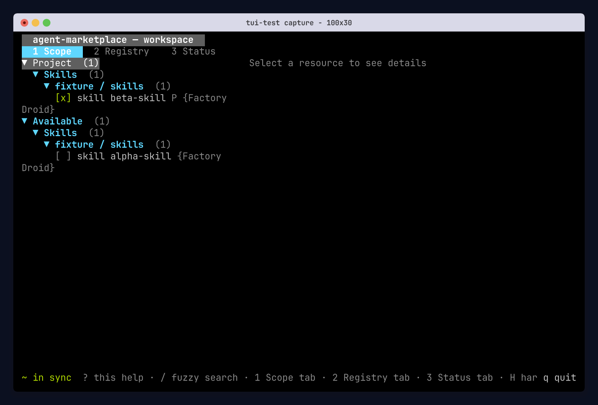

# TUI Real-Usage Tests

This package uses `@microsoft/tui-test` to launch and operate the real `agent-marketplace` binary in a PTY. Journey files send canonical user inputs and assert semantic visible outcomes plus the relevant filesystem result.

## Test ownership

- Go tests own TUI model state, asynchronous behavior, rendering contracts, and terminal-guard details.
- Go E2E tests own configuration, resource, scope, collision, ownership, harness-target, and materialization matrices.
- This package owns direct user interaction through a real PTY.

## Journeys

Each interaction contract has its own file:

1. `tests/launch-browse-inspect.spec.ts` launches bare, browses all tabs, opens details, returns, and quits.
2. `tests/search-and-select.spec.ts` searches with a positive match and disappearing distractor.
3. `tests/local-toggle-and-sync.spec.ts` toggles an available skill locally, observes pending drift, syncs, and verifies config and materialization.
4. `tests/help-and-return.spec.ts` opens help and returns to the same selection.
5. `tests/resize-and-recover.spec.ts` enters the minimum-size gate, blocks a toggle, and recovers at exactly 50x12.
6. `tests/ctrl-c-hard-exit.spec.ts` performs a bounded Ctrl+C hard exit.
7. `tests/sigterm-hard-exit.spec.ts` terminates the launcher-published target PID and verifies it is gone.
8. `tests/non-tty.test.ts` checks the two non-TTY entrypoints in a registry-free process sandbox.
9. `tests/org-marketplace-lock-failure.spec.ts` launches cold into an organization v4 Marketplace declaration whose acquisition lock is missing, verifies TUI startup, a warm selection edit, sync, and update reuse its exact resource transiently without publishing organization policy, enforces navigation/acknowledgement/settled-state budgets against a deliberately delayed acquisition, then proves CLI sync and a full user-side wipe plus re-init recover the same way.
10. `tests/org-marketplace-lock-recovery.spec.ts` runs the same exact organization Marketplace resource with its lock published and verifies the settled TUI baseline, status groups, and a passing drift check.
11. `tests/reinstall-recovery.test.ts` deletes every personal and generated layer, re-initializes, syncs back to a healthy workspace, and verifies plain sync recreates a missing repository lock.
12. `tests/status-disable-scroll.spec.ts` disables an enabled resource in an overflowing Status list and verifies that the adjacent row and its section header remain visible.
13. `tests/accept-user-migration.spec.ts` accepts the startup migration prompt, verifies that only the legacy user root converts (with a byte-exact backup) while the committed legacy repository root is untouched, then selects a repository-declared Git resource globally into the migrated user root, syncs, and passes a drift check.

Every other PTY journey declines that prompt; the acceptance journey is the only one that continues on a migrated user root.

Every PTY journey receives a fresh temporary HOME, XDG roots, workspace, temporary directory, and local bare Git registry from lifecycle hooks. The registry contains a project-selected and pre-synced `beta-skill` plus an available `alpha-skill`. Test discovery does not create fixtures. The test binary uses the existing `e2e` build tag only to redirect the fixed organization-config path into the fixture.

The two organization journeys additionally install a v4 organization layer at `<root>/etc/agent-marketplace` declaring one Marketplace source, backed by a loopback stub endpoint that serves the exact registry, revision, artifact, well-known identity document, and an empty search page. The lock-recovery fixture publishes the matching v2 organization lock. The lock-failure fixture omits it and skips fixture pre-sync so the cold TUI must acquire verified evidence in memory, reuse it through a selection edit, refresh, sync, and update, materialize the resource, and never publish organization policy. The Status-overflow journey adds thirty selected fixture skills to exercise real scrolling rather than a two-row list.

Every state-changing input is followed by a causal visible assertion before the next input. Ordinary UI and process barriers use five-second bounds; Git and materialization barriers use thirty-second bounds. The organization Marketplace journey separately enforces one second for local navigation, 3.5 seconds for write acknowledgement, and 4.5 seconds for a warm authoritative toggle. These are latency ceilings, not hang timeouts: three local baseline runs measured roughly 50 ms for navigation and 2.2 seconds for the settled toggle; a three-second injected acquisition pushes the pre-#302 toggle over five seconds while the fixed path stays below the ceiling. The CLI reacquisition after quitting proves the delayed-server control was active. The suite runs with one worker, zero retries, and identical timeout behavior locally and in CI.

## Commands

Run from the repository root:

```sh
pnpm --dir tools/tui-qa install --frozen-lockfile
make tui-qa-check
make tui-qa
```

`make tui-qa-check` typechecks the journeys and verifies the PTY adapter. `make tui-qa` builds the e2e-tagged test binary and runs every journey listed above once. Failures use the test runner's console report and current terminal screen; the suite does not write snapshots or traces.

`AM_TUI_QA_BINARY` may select an already-built test binary. `AM_TUI_QA_REPO_ROOT` may select its repository root. The default suite requires no direnv or organization-specific image, certificate, registry, or infrastructure path.

## Recording POC

`record-poc.sh` reuses the isolated QA fixture to record the browse-and-inspect
journey as a GIF:

```sh
tools/tui-qa/record-poc.sh
```

The script uses semantic `tui-test` assertions as interaction barriers and adds
short pauses only for presentation pacing. It downloads the
`tui-test 0.1.0-beta.4` release for the current macOS or Linux architecture and
checks its published SHA-256 before execution. The package remains pinned at
`0.0.4` because the beta is not yet available from the configured npm registry.

Local output is written to `tools/tui-qa/artifacts/tui-test-recording-poc/`.
The `TUI Recording POC` workflow uploads a fresh GIF and PNG as a seven-day
artifact. Its job summary embeds the checked-in preview below so the result is
visible directly in the pipeline.


